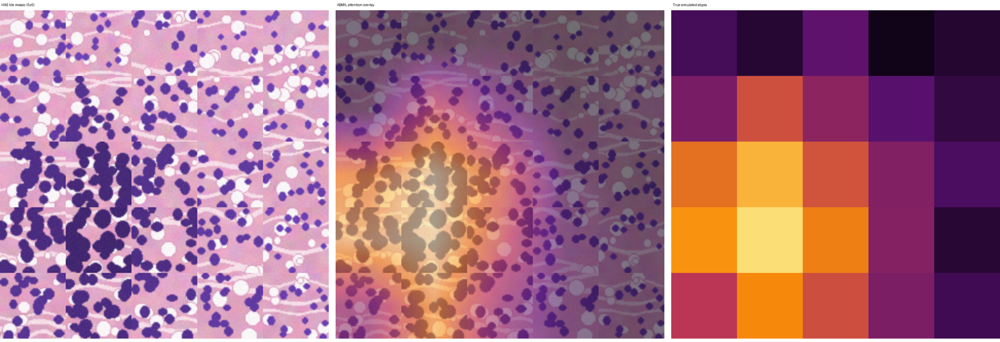
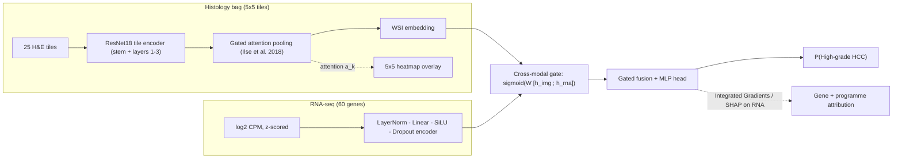

# HepatoFuse-XAI

**Attention-based multiple-instance learning (ABMIL) + RNA-seq multimodal fusion for hepatocellular carcinoma (HCC) grade prediction, with spatial and gene-level explanations.**

> ⚠️ **Synthetic data · research prototype.** The cohort (120 patients) is *generated*: it has biologically structured gene programmes, H&E-like tile morphology and a known ground truth, but it is **not patient data**. This repository demonstrates a method and a reproducible workflow, **not clinical performance**. It is not a medical device.

**Live demo:** _add your Streamlit link here_


*A held-out test patient: H&E tile mosaic · ABMIL attention overlay · true (simulated) atypia map.*

---

## What it does
For each patient the model receives
1. a **bag of 25 H&E-like tiles** arranged on a **5×5 tissue grid**, and
2. a **60-gene RNA-seq profile** (log2 CPM, z-scored),

and predicts **Low-Grade / Early HCC** vs **High-Grade / Aggressive HCC**. It then explains the prediction in two ways:
* **Spatial:** the attention weight of every tile, drawn as a heatmap over the tissue.
* **Molecular:** which genes pushed the prediction up or down (Integrated Gradients or SHAP), summed into biological programmes (proliferation, fibrosis, Wnt, hepatocyte function, …).

A Streamlit dashboard lets you pick a patient and explore the prediction, the attended tiles and the driving genes.

## Architecture


Three models are trained and compared (`src/models.py`):

| Model | Inputs | Description |
|---|---|---|
| `ImageOnlyABMIL` | tiles | ResNet18 patch encoder + gated-attention MIL pooling |
| `OmicsOnlyMLP` | RNA | LayerNorm → Linear → SiLU → Dropout gene encoder |
| `HepatoFuseMultimodal` | tiles + RNA | Cross-modal gated fusion of the WSI and RNA embeddings, with modality dropout |

## Data
`python -m src.prepare_data` writes four files to `data/`:

| File | Content |
|---|---|
| `tiles.npz` | 120 patients × 25 tiles × 64×64 px; plus a per-tile simulated atypia value (ground truth, never used for training) |
| `expression_counts.csv` | 60 genes × 120 patients (simulated counts) |
| `clinical.csv` | label, age, sex, etiology, steatosis, fibrosis stage, AFP, library size (displayed in the app, **not** model inputs) |
| `gene_annotations.csv` | gene → biological programme |

**Gene panel (60):** proliferation (*MKI67, TOP2A, …*), HCC/progenitor markers (*AFP, GPC3, EPCAM, KRT19, …*), Wnt (*CTNNB1, GLUL, AXIN1*), fibrosis (*COL1A1, COL1A2, TGFB1, …*), inflammation (*IL6, TNF, …*), angiogenesis (*VEGFA, …*), hepatocyte function (*ALB, TTR, …*), lipid metabolism, and drivers (*TP53, MYC, TERT, …*).

**Design.** Tiles show steatosis vacuoles, collagen bands and nuclear atypia concentrated in a tumour focus. Molecular aggressiveness and morphological atypia are conditionally independent given the label, and steatosis / fibrosis / inflammation act as confounders on both modalities.

**Using real data.** Replace `tiles.npz`, `expression_counts.csv` and `clinical.csv` with your own (e.g. WSI tiles or foundation-model embeddings with matched RNA-seq). The training and explanation code is unchanged apart from the tile encoder.

## Results
Held-out test set (30 patients per split), mean ± SD over 3 seeds. Scaling is fitted on the training set only.

| Model | AUROC | PR-AUC | F1 | Accuracy | Attention ↔ true-tumour-tile AUROC |
|---|---|---|---|---|---|
| Image-only ABMIL | 0.810 ± 0.048 | 0.773 ± 0.068 | 0.620 ± 0.043 | 0.700 ± 0.033 | 0.979 ± 0.025 |
| RNA-only MLP | 0.924 ± 0.048 | 0.924 ± 0.047 | 0.816 ± 0.030 | 0.833 ± 0.033 | n/a |
| **HepatoFuse (WSI + RNA)** | **0.933 ± 0.039** | 0.923 ± 0.044 | **0.860 ± 0.035** | **0.867 ± 0.033** | 0.697 ± 0.375 |

**How to read this**
* Fusion improves clearly on the image-only model. Its gain over RNA-only (0.009 AUROC) is much smaller than the seed-to-seed spread, so no superiority over RNA-only is claimed.
* Because the cohort is synthetic, the true tumour tiles are known, so explanation faithfulness can be checked: the image-only model's attention ranks them with AUROC 0.98.
* **Known limitation:** the fusion model's attention is unstable across seeds (0.85 / 0.97 / 0.27). The RNA branch can dominate while the image branch is under-trained. Planned fixes: image-branch warm-up or pre-training, stronger modality dropout, an auxiliary image-only loss.
* Test sets are small (n = 30), so all results are illustrative.

Per-seed numbers: `artifacts/per_seed_results.csv` · global gene importance: `artifacts/global_gene_importance.csv`.

## Quickstart
Requires Python 3.10+. Developed and tested with CPU PyTorch (no GPU needed).

```bash
python -m venv .venv
# Windows:  .venv\Scripts\Activate.ps1      macOS/Linux:  source .venv/bin/activate
pip install -r requirements.txt

streamlit run app.py          # trained models and data are included, so this works immediately
```

To reproduce everything from scratch (about 30 minutes on one CPU core; results can differ slightly across machines and library versions):
```bash
python -m src.prepare_data                       # synthetic cohort -> data/
python -m src.train_eval --epochs 20 --seeds 3   # training + ablation -> artifacts/
pytest -q                                        # smoke tests
```

**Deploy:** push to GitHub, then create an app on Streamlit Community Cloud with `app.py` as the main file.

## Repository layout
```
app.py                    Streamlit dashboard
requirements.txt
src/
  common.py               gene panel, data loading, stratified splits, scaling
  prepare_data.py         synthetic cohort generator
  models.py               ImageOnlyABMIL, OmicsOnlyMLP, HepatoFuseMultimodal
  train_eval.py           training, 3-seed ablation, checkpoints
  explainability.py       attention heatmaps, Integrated Gradients / SHAP, programme aggregation
tests/test_smoke.py       model shapes, attention sums to 1, split balance, IG completeness
data/                     synthetic cohort
artifacts/                trained checkpoints and result tables
assets/                   README figures
```

## Roadmap
Pathology foundation-model features in place of the from-scratch tile encoder · real whole-slide images and RNA-seq cohorts (e.g. TCGA-LIHC) · QC, stain and site harmonisation · external validation · spatial-omics and MRI branches · survival / progression endpoints · pathologist-in-the-loop evaluation of attention maps.


## References
Ilse, Tomczak & Welling. *Attention-based Deep Multiple Instance Learning.* ICML 2018 · Sundararajan, Taly & Yan. *Axiomatic Attribution for Deep Networks* (Integrated Gradients), ICML 2017 · Lundberg & Lee. *A Unified Approach to Interpreting Model Predictions* (SHAP), NeurIPS 2017.
