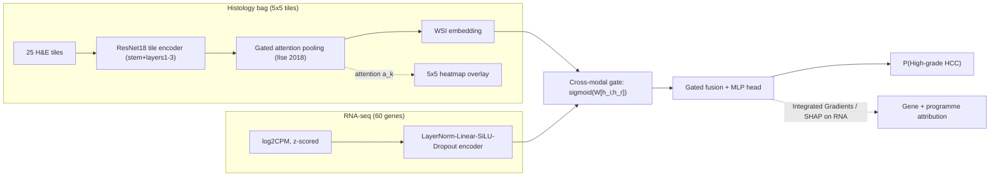

# HepatoFuse-XAI

**Attention-based multiple-instance learning (ABMIL) + RNA-seq multimodal fusion for HCC grade prediction, with spatial and gene-level explanations.**
A research prototype built as a demonstration for the PhD project *AI and Multimodal Digital Liver Pathology* (KU Leuven, Govaere Research Group, ref. BAP-2026-622).

> ⚠️ **Synthetic data, research prototype.** The cohort (120 patients) is *generated* with biologically structured gene programmes and H&E-like tile morphology plus a known ground truth. It demonstrates the **method and engineering**, not clinical performance. It is not a medical device.


*Held-out test patient: H&E tile mosaic · ABMIL attention overlay · true (simulated) atypia map.*

## Why this project
The PhD aims to combine digitised histology (WSIs) with molecular data across the MASH → ASH → HCC continuum using multiple-instance learning, multimodal integration, biological interpretability and reproducible Python + R workflows. This repo is a small, end-to-end version of exactly that loop:

| Ad requirement | Where in this repo |
|---|---|
| Multiple-instance learning on slides | `src/models.py` – ResNet18 tile encoder + gated attention pooling (Ilse et al., 2018) |
| Image–omics integration | `HepatoFuseMultimodal` – cross-modal gated fusion of WSI and RNA-seq embeddings |
| Biological interpretation / XAI | `src/explainability.py` – 5×5 tile attention heatmaps; Integrated Gradients / SHAP gene attribution aggregated to biological programmes |
| Robust, reproducible evaluation | stratified splits, scaler fit on train only, 3 seeds, ablation, `pytest`, pinned requirements |
| Python + R | `r_scripts/omics_qc_and_de.R` – normalisation, PCA QC, differential expression, volcano, heatmap |
| Communication with pathologists/clinicians | `app.py` – Streamlit decision-support dashboard |

## Architecture


## Data
`python -m src.prepare_data` creates (all in `data/`): `tiles.npz` (120 patients × 25 tiles × 64×64), `expression_counts.csv` (60 genes), `clinical.csv`, `gene_annotations.csv`.
* 60 liver genes in 9 programmes (proliferation, HCC/progenitor markers incl. *AFP, GPC3, EPCAM, KRT19*, Wnt, fibrosis incl. *COL1A1/COL1A2/TGFB1*, inflammation incl. *IL6/TNF*, angiogenesis incl. *VEGFA*, hepatocyte function incl. *ALB/TTR*, lipid metabolism, drivers incl. *TP53/CTNNB1*).
* Tiles show steatosis vacuoles, collagen bands, and nuclear atypia that concentrates in a tumour focus.
* Latent design: molecular aggressiveness and morphological atypia are conditionally independent given the label, with steatosis/fibrosis/inflammation confounders affecting both modalities. Clinical metadata are displayed in the app but **not** used as model inputs.
* To use real data (e.g. TCGA-LIHC tiles or foundation-model embeddings + RNA-seq) replace the three data files; the models/explainability are unchanged apart from the encoder input.

## Results (held-out test, 30 patients per split, mean ± SD over 3 seeds)
| Model | AUROC | PR-AUC | F1 | Accuracy | Attention↔true-tumour-tile AUROC |
|---|---|---|---|---|---|
| Image-only ABMIL | 0.810 ± 0.048 | 0.773 ± 0.068 | 0.620 ± 0.043 | 0.700 ± 0.033 | 0.979 ± 0.025 |
| RNA-only MLP | 0.924 ± 0.048 | 0.924 ± 0.047 | 0.816 ± 0.030 | 0.833 ± 0.033 | – |
| **HepatoFuse (WSI + RNA)** | **0.933 ± 0.039** | 0.923 ± 0.044 | **0.860 ± 0.035** | **0.867 ± 0.033** | 0.697 ± 0.375 |

Honest reading:
* Fusion is best on AUROC/F1/accuracy but **the AUROC gain over RNA-only (0.009) is far smaller than the seed SD** – no significant superiority is claimed. Fusion clearly improves on image-only.
* ABMIL attention reliably finds the simulated tumour tiles (0.98), as an interpretability sanity check only possible because ground truth is known.
* **Known limitation:** the fusion model's attention is unstable (per-seed 0.85 / 0.97 / 0.27): the RNA branch can dominate and the image branch is under-trained. Planned fixes: image-branch warm-up / pre-training, stronger modality dropout, auxiliary image-only loss.
* Test sets are tiny (n = 30); results are illustrative.

Per-seed numbers: `artifacts/per_seed_results.csv`. Global gene importance: `artifacts/global_gene_importance.csv`.

## Quickstart
```bash
pip install -r requirements.txt
python -m src.prepare_data                         # synthetic cohort
python -m src.train_eval --epochs 20 --seeds 3     # ~30 min on 1 CPU core; writes artifacts/
pytest -q                                          # smoke tests
Rscript r_scripts/omics_qc_and_de.R data assets/r_outputs
streamlit run app.py
```
Checkpoints and results are included in `artifacts/`, so `streamlit run app.py` works immediately. Deploy on Streamlit Community Cloud by pointing it at `app.py` (CPU PyTorch via the `--extra-index-url` line in `requirements.txt`).

> Note: `r_scripts/omics_qc_and_de.R` uses base R (and `limma` if installed). It was written but **not executed in the authoring environment** – run it once locally before relying on it.

## Roadmap towards the PhD
Real WSI features from pathology foundation models (UNI / CONCH-style) instead of a from-scratch tile encoder · TCGA-LIHC and in-house MASH/ASH cohorts · spatial-omics and MRI branches · survival / progression endpoints · stain & site harmonisation and external validation · pathologist-in-the-loop evaluation of attention maps.

## Layout
```
app.py  requirements.txt  run_all.sh
src/{common,prepare_data,models,train_eval,explainability}.py
r_scripts/omics_qc_and_de.R   tests/test_smoke.py
data/  artifacts/  assets/
```
